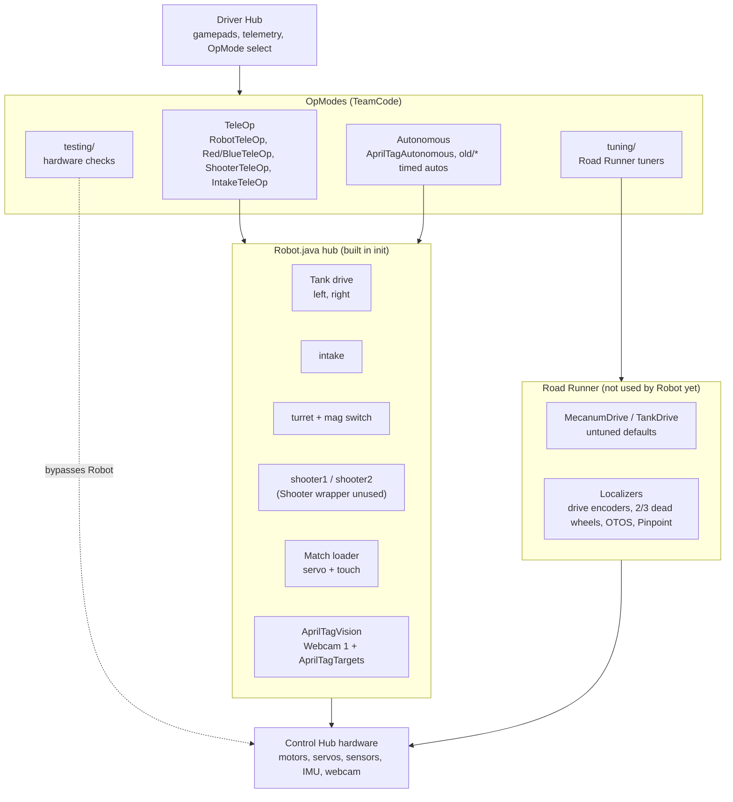
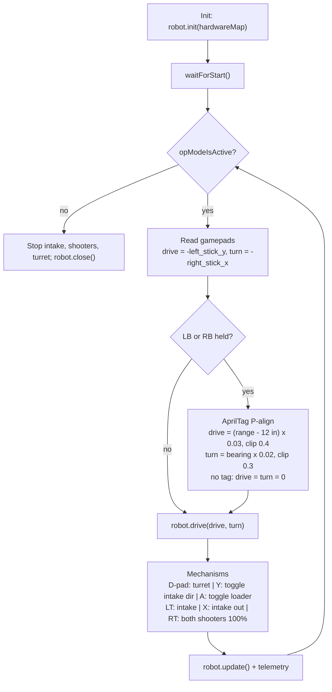
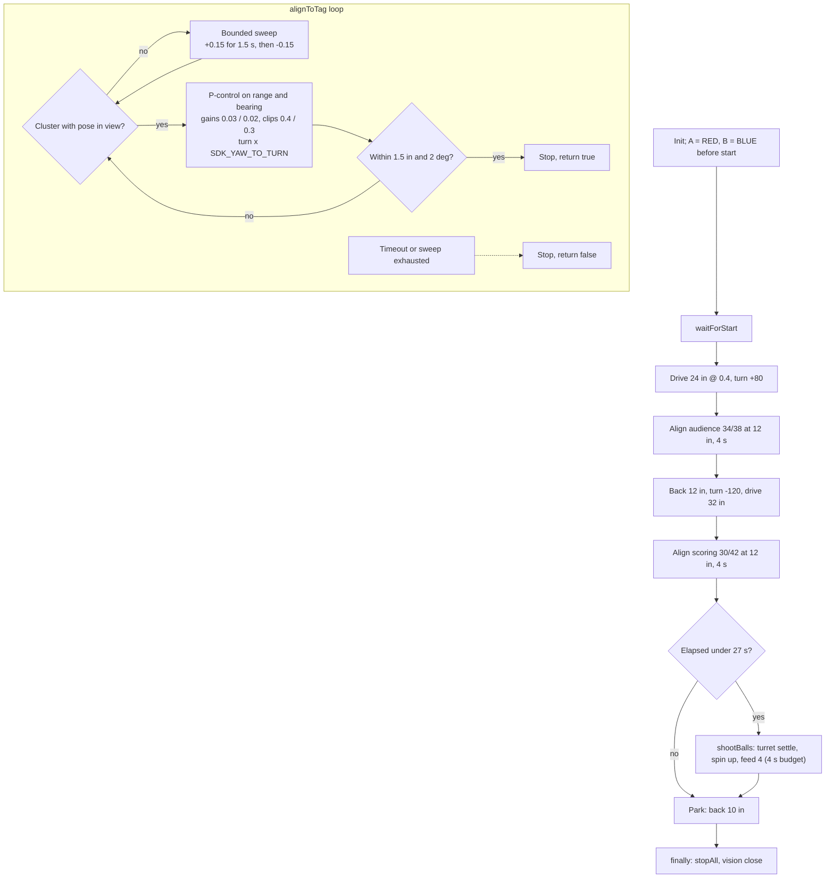
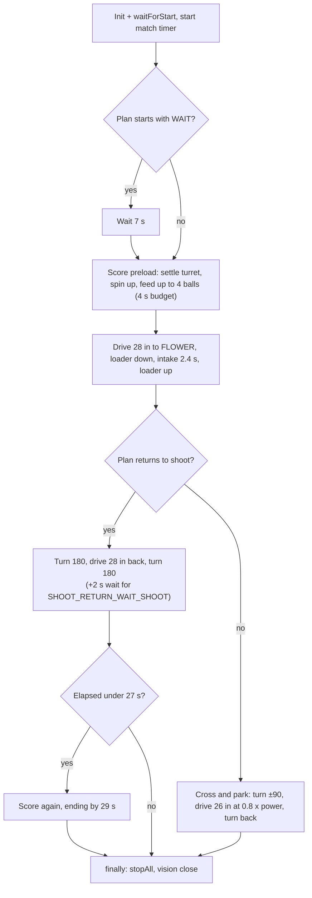
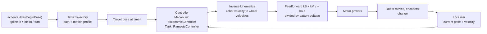

# TeamCode Design and Architecture

Single reference for how the robot code is built and how it runs. Read this before exploring the source. All team code lives in `TeamCode/`; `FtcRobotController/` is the stock FIRST SDK app (activity, empty `FtcOpModeRegister`, `@Disabled` samples) and holds no robot logic.

- Verified against branch `dev-avinash-test` (November 2026), including the autonomous rework described in section 7. Re-check the "Known issues" section after drivetrain or hardware-name changes.
- Team 36424 Underengineered Toasters. Game: BIOBUZZ (score POLLEN, intake at the FLOWER; RED/BLUE NECTAR also exist).
- Stack: FTC SDK 12.0.0, Road Runner core/actions 1.0.1 + ftc 0.1.25, FTC Dashboard 0.5.1, JDK 25, Gradle 9.6, AGP 9.4.
- Build and test: `./gradlew assembleDebug test`. CI runs both on every push/PR.

## 1. Package layout

All Java is under `TeamCode/src/main/java/org/firstinspires/ftc/teamcode/`.

| Package | Role | Uses |
|---|---|---|
| `robot/` | Production subsystems, main OpModes, AprilTag vision, Road Runner drive classes/localizers, shared autonomous helpers (`TimedMotion`, `AutoSequence`) | `Robot` hub |
| `old/` | Legacy tank-drive and timed autonomous OpModes (still registered and runnable) | `Robot` or raw `left`/`right` motors |
| `testing/` | Single-purpose hardware check OpModes for the new mecanum robot | Hardware directly, not `Robot` |
| `tuning/` | Road Runner quickstart tuning OpModes | `MecanumDrive` / `TankDrive` |
| `messages/` | FlightRecorder log record types for Road Runner | Road Runner only |
| `src/test/` | `AprilTagTargetsTest` JVM tests (no hardware) | `AprilTagTargets` |

Other TeamCode files: `res/xml/teamwebcamcalibrations.xml` (template, no custom calibration), `lib/OpModeAnnotationProcessor.jar`.

## 2. Block diagram

## 3. Hardware configuration names

The Driver Hub robot configuration must contain these names. Conflicting names are a known issue (section 9).

| Device | Name(s) used | Used by |
|---|---|---|
| Tank drive motors | `left`, `right` | `Robot`, `TankDrive`, `old/*`, `ShooterTeleOp` |
| Mecanum drive motors (Road Runner) | `leftFront`, `leftBack`, `rightBack`, `rightFront` | `MecanumDrive` |
| Mecanum drive motors (tests) | `frontleft`, `frontright`, `backleft`, `backright` | `testing/MecanumDriveTest`, `testing/OdometryTest` |
| Intake motor | `intake` | `intake` |
| Turret motor / limit switch | `turret` / `mag` (fallback `turretLimit` in test) | `turret`, `MagneticLimitSwitchTest` |
| Flywheels | `shooter1` (fallback `shooter`), `shooter2`; CRServo (SPARK Mini) tried first, then DcMotorEx | `shooter1`, `shooter2`, `Shooter` |
| Match loader | servo `matchLoader`; touch `matchLoaderTouch` (fallback `touch`) | `Robot` |
| Dead wheels | `parOdom`, `perpOdom` (Robot); `par`, `perp` (TwoDeadWheelLocalizer); `par0`, `par1`, `perp` (ThreeDeadWheelLocalizer); `frontleft`/`frontright` encoder ports (OdometryTest) | various |
| IMU | `imu` | Road Runner drives, `OdometryTest` |
| OTOS | `sensor_otos` | `OTOSLocalizer` |
| Camera | `Webcam 1` | `AprilTagVision` |
| Color sensor | `colorSensor` | `testing/ColorSensorTest` |

Wireless ADB: Control Hub `192.168.43.1:5555`, Driver Hub `192.168.43.141:5555` (robot Wi-Fi `36424-RC`). FTC Dashboard: `http://192.168.43.1:8080/dash`.

## 4. Subsystems (`robot/`)

| Class | Responsibility | Control type |
|---|---|---|
| `Robot` | Builds every subsystem in `init(hardwareMap)`. Tank `drive(forward, turn)`: `left = f + t`, `right = f - t`, clipped to ±1, BRAKE. Directions: left FORWARD, right REVERSE, so positive power and positive turn are forward and clockwise. `SDK_YAW_TO_TURN` (-1) converts SDK yaw/bearing to the `turn` argument. Match loader `setMatchLoaderDown()` (UP 0.00, DOWN 0.61 ≈ 110°) with touch-sensor retract in `update()`. `getBatteryVolts()`, `spinUpShooters()`/`spinDownShooters()`. Dead-wheel tick reads for telemetry only. `close()` stops vision. | Open loop |
| `intake` | One motor: IN +1, OUT -1, STOP 0 | Open loop |
| `turret` | Motor at ±0.40, encoder reset at init. `setPower` enforces the `mag` limit: movement continuing into an active stop is refused, reversing out is always allowed. `holdPosition`/`holdInitPosition` drive back to encoder zero (HOLD_POWER 0.30, HOLD_TOLERANCE_TICKS 40) for the static hold and autonomous aiming. | Open loop |
| `shooter1` / `shooter2` | Flywheel at 100% or 0. shooter2 motor is REVERSE. RPM estimate assumes 28 ticks/rev | Open loop |
| `Shooter` | Combined wrapper over the same names. Not used by any OpMode | Open loop |
| `AprilTagVision` | VisionPortal + AprilTagProcessor with `AprilTagGameDatabase.getCurrentGameTagLibrary()`, inch/degree output. `findTagByName`, `findTagInGroup`, `getCameraSource()` | Sensor |
| `AprilTagTargets` | SDK 12 helpers: `nameOf`, `identityOf`, `centerOf`, `matchesId`, `bioBuzzClusterForId` | Pure logic (unit tested) |
| `AlignLog` | Per-run CSV logger to `/sdcard/FIRST/debug_logs/align_<ms>.csv`. Not called anywhere | Utility |
| `Drawing` | Draws robot pose on the Dashboard field | Utility |

Init failures are swallowed with `try/catch` (most devices become `null` and are skipped). A missing webcam therefore looks like "no tags visible", not an error. `intake` and the drive motors are not wrapped and will throw if missing.

### AprilTag / BIOBUZZ clusters

SDK 12 reports BIOBUZZ goal tags as cluster detections, not single tags. Do not register these IDs as individual tags.

| Cluster | IDs |
|---|---|
| RED SCORING | 30–33 |
| RED AUDIENCE | 34–37 |
| BLUE AUDIENCE | 38–41 |
| BLUE SCORING | 42–45 |

`matchesId(detection, id)` returns true for the whole cluster containing `id`; it does not prove that particular tag was seen. Poses are relative to the camera, not absolute field positions.

## 5. OpMode catalog (Driver Hub names)

| Name | Group | Class | Drive | Notes |
|---|---|---|---|---|
| Robot TeleOp | Main | `robot/RobotTeleOp` | Robot tank | Most complete. LB = align to RED AUDIENCE, RB = RED SCORING (falls back to first visible tag). Gamepad 1 or 2 for mechanisms |
| Red Alliance TeleOp | Red | `robot/RedTeleOp` | Robot tank | Turret static hold. Gamepad 1 only. Identical to Blue except names |
| Blue Alliance TeleOp | Blue | `robot/BlueTeleOp` | Robot tank | Same as Red |
| Drive + Shooter | TeleOp | `robot/ShooterTeleOp` | Raw `left`/`right` | Opposite motor directions and turn sign to Robot |
| Intake TeleOp | TeleOp | `robot/IntakeTeleOp` | none | Intake only |
| Driver Station Test | Vision | `robot/DriverStationTestOpMode` | none | Tag telemetry |
| AprilTag Autonomous Path | Autonomous | `robot/AprilTagAutonomous` | Robot tank | Alliance chosen before start (A = RED, B = BLUE). Timed legs + audience/scoring alignment + preload shot + park. No flower/intake leg |
| Red/Blue Alliance - Wait + Return Shoot | Red/Blue | `old/RedAutonomous`, `old/BlueAutonomous` | Robot tank | `BioBuzzTimedAuto` plan WAIT_SHOOT_RETURN_SHOOT |
| Red/Blue Alliance - Shoot Now + Return | Red/Blue | `old/RedShootNowAuto`, `old/BlueShootNowAuto` | Robot tank | SHOOT_RETURN_WAIT_SHOOT |
| Red/Blue Alliance - Wait + Cross + Park | Red/Blue | `old/RedCrossWaitAuto`, `old/BlueCrossWaitAuto` | Robot tank | WAIT_SHOOT_CROSS_PARK |
| Red/Blue Alliance - Shoot Now + Cross + Park | Red/Blue | `old/RedCrossNowAuto`, `old/BlueCrossNowAuto` | Robot tank | SHOOT_CROSS_PARK |
| Basic Out and Back Auto | Autonomous | `old/BasicAutonomous` | Robot tank | Negates both drive axes (comment says chassis moves backward on positive power) |
| Basic Autonomous | Autonomous | `old/BasicParkingAutonomous` | Raw `left`/`right` | Forward 7/46/7/46 in with turns, back 7 in |
| Parking Autonomous | Autonomous | `old/ParkingAutonomous` | Raw `left`/`right` | Back 7 in, right 90°, back 46 in |
| Basic Tank Drive | TeleOp | `old/BasicTankDrive` | Raw `left`/`right` | Opposite motor directions to Robot |
| Mecanum Drive Test | Testing | `testing/MecanumDriveTest` | 4 mecanum motors | Left stick: forward + strafe, right stick X: rotate. FL and BR reversed |
| Odometry Sensor Test | Testing | `testing/OdometryTest` | none (push by hand) | Pods on `frontleft`/`frontright` encoder ports + IMU |
| Ball Identifier | (none) | `testing/ColorSensorTest` | none | RGB ratios → RED NECTAR / POLLEN / BLUE NECTAR |
| Magnetic Limit Switch Test | Test | `testing/MagneticLimitSwitchTest` | none | `mag` as TouchSensor or DigitalChannel |
| AprilTag Test | Vision | `testing/AprilTagTestOpMode` | none | Tag telemetry |
| quickstart group | quickstart | `tuning/TuningOpModes` | `DRIVE_CLASS` (currently `MecanumDrive`) | Registers Road Runner tuners, `LocalizationTest`, `ManualFeedbackTuner`, `SplineTest` |

## 6. TeleOp control flow

Every TeleOp is a `LinearOpMode` with this shape. `RobotTeleOp` shown (the only one with auto-align).

Red/Blue TeleOp differ: no auto-align; when the D-pad is idle the turret returns at 0.30 power if more than 150 ticks from its init position (bang-bang); gamepad 1 only; loader state resets when the touch sensor fires.

## 7. Autonomous control flows

### Shared timed-route layer (`robot/TimedMotion`, `robot/AutoSequence`)

Every timed route converts motion in one place instead of carrying its own constants.

- `TimedMotion` owns the calibration and the movement loop: `inchesPerSecondAtHalfPower` 20, `turnPower` 0.45, `degreesPerSecondAtTurnPower` 150, `nominalBatteryVolts` 12. Every move applies `seconds x 12 V / actual volts`, calls `Robot.update()` each iteration (so loader touch safety works in autonomous too) and always stops the drivetrain before returning. `forRobot(...)` adapts `Robot`; `forRawMotors(...)` adapts the legacy `left`/`right` OpModes. The conversions are unit tested in `TimedMotionTest`.
- `AutoSequence` owns autonomous actions: `settleTurret` (return to encoder zero), `shootBalls` (spin up, then feed one ball per cycle inside a time budget), `intakeAtFlower`, `alignToTag` (range/bearing P-control with a bounded two-sided search sweep) and `stopAll`.
- `Robot.SDK_YAW_TO_TURN` is -1. SDK yaw/bearing is positive counter-clockwise; `Robot.drive`'s turn is positive clockwise. Every SDK-derived heading must be multiplied by it.

### AprilTagAutonomous (alliance selectable)

### BioBuzzTimedAuto (old/, 8 Red/Blue subclasses)

Distance and heading are converted by `TimedMotion`: `seconds = inches / (20 in/s x power/0.5)` and `seconds = degrees / (150 deg/s x power/0.45)`, both scaled by `12 V / battery voltage`. One calibration now serves every route, including both legacy parking OpModes; calibrate it once (measure an actual 90° turn at 0.45 power) and all routes follow.

All autonomous routines are still dead reckoning by time. Only `alignToTag` uses sensor feedback, only `AprilTagAutonomous` (and any route calling `AutoSequence.shootBalls`) releases a ball, and no route knows its starting pose. None use Road Runner.

## 8. Road Runner motion stack

### Trajectory following loop

Each `FollowTrajectoryAction.run()` / `TurnAction.run()` call is one loop iteration; it returns false and zeroes motors when `t >= duration`. Run with `Actions.runBlocking(...)`. Pose, target and commands are logged through `FlightRecorder` and drawn on FTC Dashboard.

### MecanumDrive vs TankDrive

| | MecanumDrive | TankDrive |
|---|---|---|
| Motors | `leftFront`, `leftBack`, `rightBack`, `rightFront` | `left`, `right` (lists; add motors per side if needed) |
| Motion | Holonomic: forward, strafe, turn independently (`strafeTo` works) | Non-holonomic: paths must be tangent-continuous; separate `turn()` for heading |
| Path controller | `HolonomicController` (axial/lateral/heading position + velocity gains) | `RamseteController` (`ramseteZeta`, `ramseteBBar`) |
| Turn controller | Same holonomic gains | `turnGain`, `turnVelGain` |
| Default localizer | 4 drive encoders + IMU heading | Left/right drive encoders |
| Motor directions | TODO, none set | TODO, none set (Robot uses right REVERSE) |

### Parameters and tuning status (all untuned)

| Parameter | Mecanum | Tank | Meaning | Tuner |
|---|---|---|---|---|
| `inPerTick` | 1 | 0 (divide by zero in feedforward) | Inches per encoder tick | `ForwardPushTest` |
| `lateralInPerTick` | = inPerTick | n/a | Strafe slip correction | `LateralPushTest` / `LateralRampLogger` |
| `trackWidthTicks` | 0 | 0 | Effective wheel track | `AngularRampLogger` |
| `kS`, `kV` | 0, 0 | 0, 0 | Static and velocity feedforward | `ForwardRampLogger` |
| `kA` | 0 | 0 | Acceleration feedforward | `ManualFeedforwardTuner` |
| Path gains | all 0 | zeta 0.7, bBar 2.0 (usually fine) | Feedback correction | `ManualFeedbackTuner` |
| Turn gains | shared heading gains, 0 | `turnGain`, `turnVelGain` = 0 | Turn feedback | `ManualFeedbackTuner` |
| Profile | maxWheelVel 50, accel -30/+50, maxAngVel π, maxAngAccel π | same | Path aggressiveness | Lower first, raise later |
| IMU orientation | Logo UP, USB FORWARD | same | Must match hub mounting | Physical check |

Tuning order: set `TuningOpModes.DRIVE_CLASS` → `MecanumMotorDirectionDebugger` / `DeadWheelDirectionDebugger` → `ForwardPushTest` → `LateralPushTest` (mecanum) → `ForwardRampLogger` → `LateralRampLogger` (mecanum) → `AngularRampLogger` → `ManualFeedforwardTuner` → `ManualFeedbackTuner` → `LocalizationTest` → `SplineTest`. Docs: https://rr.brott.dev/docs/v1-0/tuning/

Notes:
- `PARAMS` feeds kinematics and constraints in the constructor; restart the OpMode after Dashboard edits, and copy final values into the Java source.
- To use dead wheels, replace `localizer = new DriveLocalizer(pose)` with e.g. `new TwoDeadWheelLocalizer(hardwareMap, lazyImu.get(), PARAMS.inPerTick, pose)` and align names (`par`/`perp` vs Robot's `parOdom`/`perpOdom`). goBILDA pods (2000 ticks/rev, 32 mm) give `inPerTick` ≈ 0.00198.
- `TankDrive` already uses `left`/`right`, so it is the shortest path to Road Runner on the current tank chassis.

## 9. Known issues and inconsistencies

1. Four drivetrain naming schemes (section 3). One robot configuration cannot satisfy `Robot`, `MecanumDrive` and `testing/` at once; OpModes for the other scheme crash at init.
2. Tank drive direction and turn sign still disagree across files:
   - `Robot` (and every route built on it): left FORWARD, right REVERSE, positive power = forward, positive turn = clockwise.
   - `BasicTankDrive`, `ShooterTeleOp`: left REVERSE, right FORWARD. `BasicTankDrive` is self-consistent; `ShooterTeleOp` negates both stick axes on top, so it drives backward on forward stick and steers upside down.
   - TeleOps use `turn = -right_stick_x`, which makes pushing the stick right turn the robot left. At most one of these conventions is right; verify on blocks and fix once.
3. `RobotTeleOp` auto-align is still inverted: it uses `turn = bearing * P_TURN_GAIN` without `Robot.SDK_YAW_TO_TURN`, so LB/RB steers away from the tag while `AutoSequence.alignToTag` steers toward it. Autonomous is fixed; TeleOp is not.
4. `MecanumDriveTest` reverses FL and BR (usual pattern reverses both left motors). Confirm per wheel. Its on-screen help text swaps the rotate/strafe sticks.
5. `shooter1`, `shooter2` and `Shooter` all claim the same flywheel hardware, and `Robot.init` initializes all three even though no OpMode uses `Shooter`.
6. Flywheels are open-loop 100% power; shot speed drops with battery (see branch `feature/shooter-pidf`).
7. `AutoSequence.loaderIsFeed` assumes the match loader is the ball feed (down = release, up = re-arm). Confirm on the robot; if the ball is released in the up position, flip that flag instead of editing the sequence.
8. AprilTag cluster IDs resolve to the cluster centroid, not to an individual tag. `AprilTagAutonomous` also uses 12 in for both approach and shooting range; set `scoringRangeInches` to the flywheel's effective range.
9. `AprilTagAutonomous` has no flower leg, so it scores the preload only. `BioBuzzTimedAuto` scores twice but has no vision.
10. New autonomous calibration that still needs a field measurement: `TimedMotion` turn/distance constants, `turret.HOLD_TOLERANCE_TICKS`, `AutoSequence` feed/spin-up times.
11. Red/Blue turret hold is still a 0.30-power bang-bang rather than `turret.holdPosition`; Red and Blue TeleOps are identical. The turret limit is now enforced inside `setPower`, so the bang-bang can no longer stall into the stop.
12. Road Runner is untuned and unused by competition OpModes; `DRIVE_CLASS` is `MecanumDrive` on a two-motor robot, and `TankDrive` with `inPerTick = 0` produces infinite feedforward.
13. Dead wheels are read only for telemetry. `AlignLog`, `Drawing.getCameraSource`, `AprilTagVision.findTagInGroup` and `Shooter` are unused.
14. Camera init failures are silent, and AprilTag decimation/exposure are unset, so detections drop out during fast movement.
15. Empty directory `FTC_-UnderEngineeredToasters27/` at the repo root is a clone artifact.

## 10. Direction of work

The team is moving from the 2-motor tank to a 4-motor mecanum chassis (see `old/AGENTS.md`, `testing/`, branch `feature/mecanum-drive-controls`). Suggested order:

1. Pick the drivetrain on the field and one hardware naming scheme; update `Robot`, Road Runner and `testing/` to match.
2. Fix motor directions and turn sign once, in one place: apply `Robot.SDK_YAW_TO_TURN` to the TeleOp alignment and settle the stick/`drive()` convention (issue 2 and 3 above).
3. Calibrate the shared autonomous constants (`TimedMotion` distance/turn, `AutoSequence` feed times, `turret` hold) and confirm `loaderIsFeed`; then verify a full BIOBUZZ route scores.
4. Tune Road Runner (section 8) and enable dead-wheel localization.
5. Rebuild autonomous as Road Runner trajectories, using AprilTag alignment only for final correction, and add the flower/intake leg to `AprilTagAutonomous`.
6. Replace open-loop flywheels with velocity control.

Active remote branches: `dev`, `dev-avinash-test`, `feature/driver-station-port`, `feature/flower-touch-stop`, `feature/mecanum-drive-controls`, `feature/mono-camera-bringup`, `feature/shooter-pidf`.
